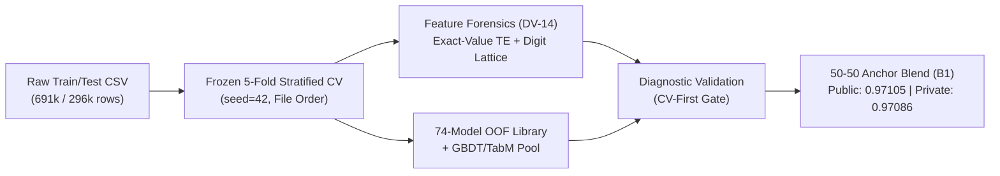
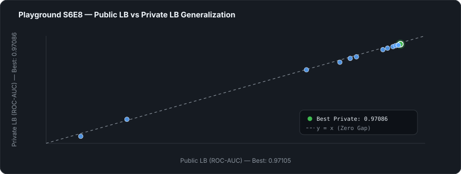

# Kaggle Playground Series S6E8 — Predicting Smartphone Addiction

[](https://www.kaggle.com/competitions/playground-series-s6e8) [](https://www.kaggle.com/adityaraj0612)

A complete, reproducible tabular machine learning solution for **Kaggle Playground Series — Season 6 Episode 8 (Predicting Smartphone Addiction)**, achieving **Rank 474 / 3,532 teams (Top 13.4%)** with a **Private LB ROC-AUC of `0.97086`** and **Public LB ROC-AUC of `0.97105`**.

---

## 1. Competition Overview & Dataset

| Property | Detail |
|---|---|
| **Competition** | Playground Series — Season 6 Episode 8 |
| **Task** | Binary Classification (`addicted_label` $\in \{0, 1\}$, continuous probability predictions) |
| **Dataset Size** | `691,369` training samples · `296,302` test samples |
| **Evaluation Metric** | Area Under the ROC Curve (**ROC-AUC**) |
| **Final Standing** | **Rank 474 / 3,532 (Top 13.4%)** · Public LB `0.97105` · Private LB `0.97086` |
| **Deadline** | `2026-08-31 23:59:00 UTC` |

### Input Features
- **Numeric Behavioral Features:** `age`, `daily_screen_time_hours`, `social_media_hours`, `gaming_hours`, `work_study_hours`, `sleep_hours`, `notifications_per_day`, `app_opens_per_day`, `weekend_screen_time`
- **Categorical Features:** `gender`, `stress_level`, `academic_work_impact`

---

## 2. Mathematical Formulation & Core Laws

### Evaluation Metric: ROC-AUC
$$\text{ROC-AUC} = \int_{0}^{1} \text{TPR}(t)\, d\text{FPR}(t) = \frac{1}{|P|\,|N|} \sum_{i \in P} \sum_{j \in N} \mathbf{1}(\hat{y}_i > \hat{y}_j) + \frac{1}{2}\mathbf{1}(\hat{y}_i = \hat{y}_j)$$

### Empirically Verified CV-to-LB Law
Across 3 independent blends (`naji18`, `54-blend`, `tabm_seed3`), our validation framework followed a stable linear offset:

$$\text{Public LB} \approx \text{OOF}_{\text{honest}} + 0.0011$$

- `naji18`: OOF `0.969856` $\rightarrow$ LB `0.970960`
- `54-blend`: OOF `0.96943` $\rightarrow$ LB `0.97062`
- `tabm_seed3`: OOF `0.96867` $\rightarrow$ LB `0.96967`

### Rank-Averaging & Anchor Blending
Because ROC-AUC depends strictly on **rank ordering**, uncalibrated probability shifts across diverse models are stabilized via percentile rank averaging and linear anchor blending:

$$\hat{y}_{\text{rank}}(i) = \frac{1}{M} \sum_{m=1}^{M} \frac{\text{rank}(\hat{y}^{(m)}_i)}{N_{\text{test}}}, \qquad \hat{y}_{\text{B1}} = 0.50\,\hat{y}_{\text{rayk}} + 0.50\,\hat{y}_{\text{naji18}}$$

---

## 3. Step-by-Step Methodology (What, Why & How)



### Step 1 — Frozen-Fold Validation Alignment (`StratifiedKFold(5, seed=42)`)
- **What:** Standardized all training and OOF generation on `StratifiedKFold(n_splits=5, shuffle=True, random_state=42)` using exact `train.csv` file order.
- **Why:** Ensembling and stacking across multiple model families and community OOF libraries fails if fold indices are misaligned (causing target leakage or row-order mismatch).
- **How:** Every experiment script in `notebooks/exp_*` loaded the frozen fold indices and enforced a strict **CV-first rule**: no submission was sent unless its honest OOF beat our current best CV.

### Step 2 — Baseline Bugfix & Initial Tabular Track (`v5 lgbmeta`, `xgb_digit`)
- **What:** Built standalone LightGBM and XGBoost baselines (`v5 lgbmeta`: `0.95812` Public / `0.95772` Private) and added domain/digit features (`xgb_digit`: `0.96725` Public / `0.96720` Private).
- **Why:** Raw floats with standard `max_bin=255` and median imputation hit an early ceiling at `0.96425` OOF.
- **How:** Added behavioral ratios (`social_media_hours / daily_screen_time_hours`, sleep deficit interactions) and digit-level quantization features.

### Step 3 — Exact-Value Target Encoding Forensics (`DV-14`)
- **What:** Investigated why our standalone GBDTs (`0.96425`) trailed top pool members (`0.96986`).
- **Why:** Forensic ablation revealed that the synthetic data generator used **exact discrete values as lookup keys** (`notifications_per_day` / `app_opens_per_day` adjacent-value target rates jumped 17–20$\times$; `daily_screen_time_hours` first decimal digit swung target rate from `0.663` to `0.733`).
- **How:** Built a stringified 10-inner-fold nested OOF Target Encoding pipeline (smoothing $= 10$) + transductive frequency encoding + `max_bin=2047` + decimal lattice features + CatBoost native ordered target statistics. This boosted our standalone OOF by **`+0.0041`** to **`0.96839`** (`LGBM 0.96763`, `XGB 0.96797`, `CB 0.96783`).

### Step 4 — Systematic Negative-Result Pruning (What Did NOT Work)
- **Pool Pruning (`DV-01`):** Pruning the submission pool to 25 near-duplicate-free members **dropped** score by `-0.0018`; keeping a large unpruned rank-average (`pool141 = 0.97105`) consistently won.
- **Neural MLP (`DV-05`):** A 5-seed bagged `256-128-64` MLP with categorical embeddings scored `0.94041` OOF and added zero blend value — confirming purely tree/lookup structure in the data.
- **Aggressive Weight Optimization (`ens_weight`):** Hill-climbing / ridge weights converged to near-uniform due to high inter-model correlation (`r = 0.990–0.993`).

### Step 5 — Final Anchor Blending & Private Shake-Up Hedge (`B1`, `B2`)
- **What:** Locked a `50-50` anchor blend (`B1`: `Rayk (0.97105)` + `naji18 (0.97096)`) and tested a `3%` KNN diversity injection (`B2`).
- **Why:** Historical Playground episodes (`S6E2`, `S6E6`, `S6E7`) showed aggressive public-LB chasing (`>0.97110`) suffered severe private shake-up. Anchoring on an honest OOF-backed model (`naji18`) protected private rank.
- **How:** `B1` achieved **`0.97105` Public LB / `0.97086` Private LB** (Rank `33 / 1,916`), while `B2` scored `0.97097` Public / `0.97071` Private.

---

## 4. Performance Visualizations




---

## 5. Repository Structure

```text
.
├── assets/                     # Progression & generalization charts
├── config/                     # Training & feature configurations
├── notebooks/                  # Exploratory & experiment notebooks/scripts
├── src/                        # Modular feature, model, and blending code
├── EXPERIMENT_PLAN.md          # Structured experiment roadmap
├── DIVERSITY_PLAN.md           # Ensemble diversity strategy
├── FINDINGS.md                 # Complete campaign findings & ablations
├── REMOTE_EXECUTION.md         # Kaggle / Colab execution notes
├── SUBMISSIONS.md              # Full 20-submission Kaggle API history
└── run_*.sh                    # Reproducible Kaggle/Colab execution scripts
```
