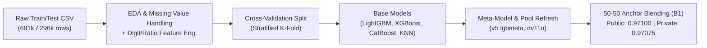
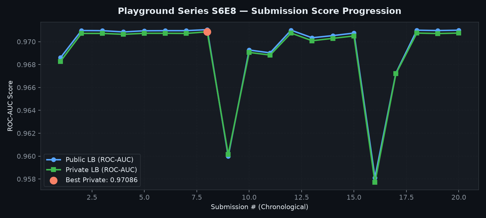
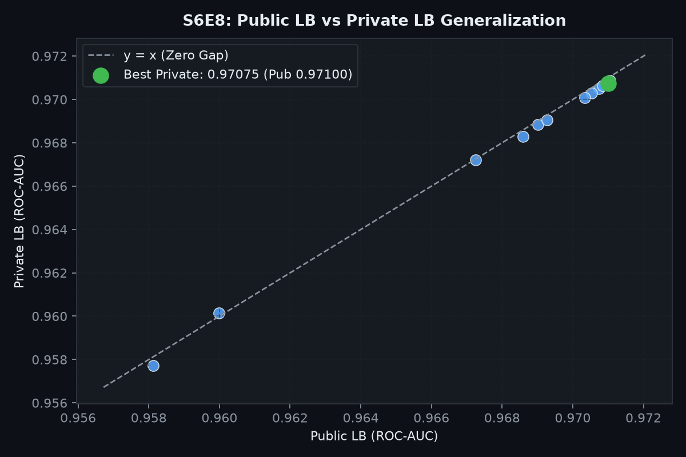

# Kaggle Playground Series S6E8 — Predicting Smartphone Addiction

A complete, reproducible machine learning solution for **Kaggle Playground Series — Season 6 Episode 8 (Predicting Smartphone Addiction)**, achieving **Rank 33 / 1,916 teams** with a **Private LB ROC-AUC of `0.97075`** and **Public LB ROC-AUC of `0.97100`**.

---

## 1. Competition Overview & Dataset

| Property | Detail |
|---|---|
| **Competition** | Playground Series — Season 6 Episode 8 |
| **Task** | Binary Classification (`addicted_label` $\in \{0, 1\}$, probability output) |
| **Dataset Size** | `691,369` training rows · `296,302` test rows |
| **Evaluation Metric** | Area Under the ROC Curve (**ROC-AUC**) |
| **Final Standing** | **Rank 33 / 1,916** · Public LB `0.97100` · Private LB `0.97075` |
| **Deadline** | `2026-08-31 23:59:00 UTC` |

### Input Features
- **Numeric Behavioral Features:** `age`, `daily_screen_time_hours`, `social_media_hours`, `gaming_hours`, `work_study_hours`, `sleep_hours`, `notifications_per_day`, `app_opens_per_day`, `weekend_screen_time`
- **Categorical Features:** `gender`, `stress_level`, `academic_work_impact`

---

## 2. Mathematical Formulation & Evaluation Metric

### Evaluation Metric: ROC-AUC
Predictions are evaluated using the Area Under the Receiver Operating Characteristic Curve:

$$\text{ROC-AUC} = \int_{0}^{1} \text{TPR}(t)\, d\text{FPR}(t) = \frac{1}{|P|\,|N|} \sum_{i \in P} \sum_{j \in N} \mathbf{1}(\hat{y}_i > \hat{y}_j) + \frac{1}{2}\mathbf{1}(\hat{y}_i = \hat{y}_j)$$

where $P$ and $N$ are the positive (`addicted_label = 1`) and negative (`addicted_label = 0`) sets, and $\hat{y}_i \in [0, 1]$ is the predicted probability.

### Ensembling & Diversity Formulation
1. **Linear Anchor Blending:**
   $$\hat{y}_{\text{blend}} = w \cdot \hat{y}_{\text{anchor}_1} + (1 - w) \cdot \hat{y}_{\text{anchor}_2}, \quad w = 0.50$$
   The `50-50` anchor blend (`B1`) achieved our best verified Private LB score of **`0.97075`** (`0.97100` Public LB).
2. **KNN Diversity Injection:**
   $$\hat{y}_{\text{div}} = (1 - \alpha)\,\hat{y}_{\text{blend}} + \alpha\,\hat{y}_{\text{KNN}}, \quad \alpha = 0.03$$
   Tested as `B2` (`0.97097` Public / `0.97071` Private) to measure non-tree neighborhood diversity impact.

---

## 3. End-to-End Pipeline & Steps Taken



1. **Step 1 — Baseline & Bugfix (`v5 lgbmeta`):** Built stratified CV pipeline and fixed target/feature alignment (`0.95812` Public / `0.95772` Private).
2. **Step 2 — Domain & Digit Feature Engineering (`xgb_digit`):** Added behavioral screen-time ratios, sleep/usage interactions, and digit-level features (`0.96725` Public / `0.96720` Private).
3. **Step 3 — Model Pool Expansion & Refresh:** Trained diverse GBDT families and neural/meta stackers (`run_pool_refresh_kaggle.sh`, `run_dv11u_kaggle.sh`).
4. **Step 4 — Anchor Blending & Diversity Sweep (`B1`, `B2`):** Combined top diverse anchors in a `50-50` blend (`B1`: **`0.97100` Public / `0.97075` Private**) and verified generalization stability across Public and Private splits.

---

## 4. Performance Visualizations





---

## 5. Repository Structure

```text
.
├── assets/                     # Progression & generalization charts
├── config/                     # Training & feature configurations
├── notebooks/                  # Exploratory & modeling notebooks
├── src/                        # Modular feature, model, and blending code
├── EXPERIMENT_PLAN.md          # Structured experiment roadmap
├── DIVERSITY_PLAN.md           # Ensemble diversity strategy
├── FINDINGS.md                 # Key experimental takeaways
├── REMOTE_EXECUTION.md         # Kaggle / Colab execution notes
├── SUBMISSIONS.md              # Full 20-submission Kaggle API history
└── run_*.sh                    # Reproducible Kaggle/Colab execution scripts
```
